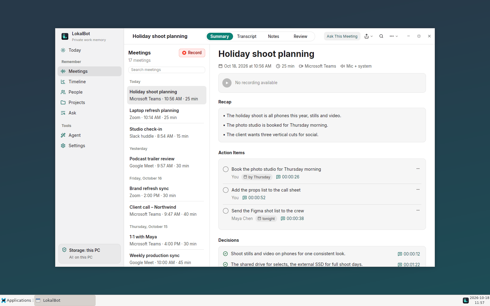
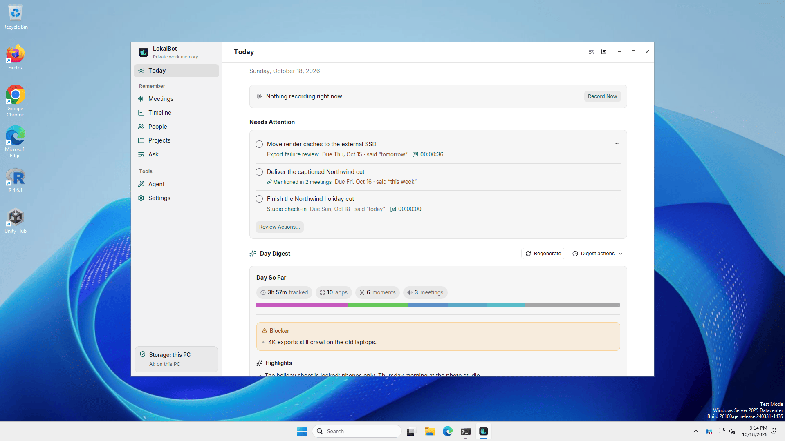

# LokalBot for Linux and Windows

A native Rust port of LokalBot built with [GPUI](https://github.com/zed-industries/zed/tree/main/crates/gpui),
Zed's GPU-accelerated UI framework, and [GPUI Kit](https://github.com/longbridge/gpui-kit). It follows the
macOS app's experience (the same Today, Meetings, Timeline, People, Projects, Ask and Settings) and its
library format, so a library recorded on one platform opens on the other. Recording, transcription,
summaries, search and the read-only CLI/MCP server all run on your computer by default.

It is an **alpha**: the Windows build isn't code-signed yet, some features depend on your Linux desktop,
and a few macOS features haven't been ported (see below). Bug reports are welcome.

<p>
  
  
</p>

More screenshots of both apps are in [docs/screenshots](docs/screenshots).

## What works where

| Feature | Linux | Windows | Notes |
| --- | --- | --- | --- |
| Meetings: record mic + system audio | ✓ (PulseAudio/PipeWire monitor) | ✓ (WASAPI loopback) | No bot joins the call. Tracks are 16 kHz WAV files; meetings recorded on macOS (AAC `.m4a`) play and transcribe too. A recording cut short by a crash or power loss is closed at its last audio when LokalBot starts again, then processed as usual. |
| On-device transcription | ✓ | ✓ | sherpa-onnx: Qwen3-ASR 0.6B by default; Parakeet v3, SenseVoice and Whisper turbo optional. Speakers are separated with pyannote segmentation and TitaNet embeddings. |
| Notes, actions, decisions, day digest, project notes, follow-up drafts | ✓ | ✓ | The macOS prompts, run by the built-in llama.cpp server (Vulkan or CPU), Ollama, an OpenAI-compatible server you approve, or your own ChatGPT or Claude plan (see [Think providers](#think-providers)). Follow-ups are written only by a model on your computer, and LokalBot never sends them. |
| Ask with citations | ✓ | ✓ | As on macOS, the model looks things up with tools (search, list and read meetings, action items, screen text, app activity) and answers once it has enough; each citation must match a source a tool returned. A Think model running on the CPU, or one with a context window under 16K tokens, instead gets the relevant meetings found first (keyword and meaning search) and answers in one turn. |
| Keyword and meaning search, Quick Recall | ✓ | ✓ | SQLite FTS5 plus EmbeddingGemma vectors, kept up to date in the background. |
| Day memory (app and window activity) | X11, Hyprland, Sway, KDE; GNOME with the Window Calls extension | ✓ | Window titles are cleared after the retention window in Privacy settings. |
| Screen context (visible text, optional encrypted screenshots) | X11; Sway and Hyprland with `grim`; other Wayland desktops through the screenshot portal when it can capture just the active window | ✓ | Off until you choose it in Settings → Day Memory. Text comes from accessibility (AT-SPI, UI Automation) and on-device OCR (ocrs, downloaded on request); screenshots are AES-GCM encrypted with a key in the system credential store. |
| Dictation (hold a shortcut, speak, release) | X11; Wayland through your compositor's shortcut + `lokalbot dictate` | ✓ | Transcribe inserts what you said; Compose rewrites it with the Think model. Pastes at the cursor, or copies to the clipboard when it cannot. |
| Meeting detection | ✓ (PulseAudio source outputs) | ✓ (WASAPI capture sessions) | Asks with a notification by default. |
| System tray, launch at login | ✓ (StatusNotifierItem; GNOME needs the AppIndicator extension) | ✓ | |
| `lokalbot-cli` + MCP for coding agents | ✓ | ✓ | Read-only, off until you allow it in Settings → Privacy & Data. |
| Signed automatic updates | ✓ (installed with `install.sh`, or run from the extracted folder) | ✓ (run from the extracted folder) | Checks GitHub daily; installs only when you choose Install and Relaunch. Package installs are told how to update with the package manager; other copies under `/usr`, `/opt` or Program Files are pointed at the download. |
| Live transcript preview while recording | ✓ | ✓ | Opt-in from the live meeting view. Each track is transcribed in 4–12 s chunks cut at a pause, as Me and Remote speaker; the full transcript replaces it after the meeting. |
| Autocomplete in other apps | X11 (GTK; Qt, Chromium/Electron and Firefox once system accessibility is on); Wayland: the practice editor in Settings only | ✓ (apps whose fields support UI Automation) | Off until you turn it on in Settings → Writing. LFM2.5 1.2B on this computer by default, about 250 ms to a suggestion on CPU. Tab accepts a word, Esc dismisses. Password fields, terminals and excluded apps are never read, and nothing is stored. |
| Agent Mode | ✓ | ✓ (Git Bash, or PowerShell without it) | Runs the pi coding agent with your Think model. Setup downloads Bun and pi (pinned and checksum-verified, about 65 MB on Linux and 70 MB on Windows). File changes and commands need your approval. |
| Import recordings, merge meetings, meeting boundaries | ✓ | ✓ | Import an audio or video file from the Meetings header or by dropping it on the list: MP3, M4A/AAC, MP4/MOV, WAV, AIFF, CAF, FLAC, Ogg Vorbis and MKV (not Opus). Every audio track is mixed into the meeting's `system.wav`. Ctrl-click or Shift-click meetings to merge them into one timeline, with Undo; **Meeting boundaries…** keeps part of a recording and rebuilds its notes. A Mac reads the WAV tracks these write. |
| Calendar | ✓ (private iCal/CalDAV links; Evolution Data Server, including GNOME Online Accounts) | ✓ (private iCal/CalDAV links) | Off until you turn it on in Settings → Meetings. Titles and stamps recordings like macOS, backs browser calls with the event's meeting link, splits back-to-back meetings, suggests attendee names for speakers, and lists today's meetings on Today with Join, Record and a pre-meeting brief from the local Think model. Links are kept in the system credential store. |
| Spoken summaries, coding-agent sessions in day memory, selection actions, meeting note export and daily memory notes, About you | — | — | macOS only for now. |

## Think providers

Think (notes, digests, Ask, Compose) runs on the built-in model by default. On a PC without a
supported GPU, local models are slow, so Settings → Models → Connections also offers:

- **OpenAI-compatible server**: any `/v1` URL, such as OpenRouter, OpenAI, Cerebras, LM Studio or
  llama-server. With OpenRouter, **Provider data use** keeps every request on private endpoints
  (providers that do not collect inference data) unless you choose to follow your OpenRouter
  privacy settings. A URL on `api.anthropic.com` uses Anthropic's Messages API, with structured
  output, effort control and prompt caching for the system prompt and transcript.
- **Ollama**, on this PC or another one.
- **ChatGPT plan**: **Continue with ChatGPT** signs in through your browser (OpenAI's Sign in with
  ChatGPT) and returns to LokalBot on `127.0.0.1`. Requests go to OpenAI's Responses API and count
  toward your plan. The sign-in is kept only in the system credential store; on a Linux desktop
  without a Secret Service (GNOME Keyring, KWallet) it cannot be used.
- **Claude plan**: runs the Claude Code you installed and signed in to yourself (`claude` on PATH,
  in `~/.local/bin`, or npm's `claude.cmd` on Windows), with its tools, MCP servers, settings and
  session history turned off. LokalBot never sees your Claude credentials.

Every remote server and each plan needs its own approval before any context leaves your computer.
Agent Mode runs on the built-in model, Ollama or an OpenAI-compatible server, not on a plan.

## Install

Download the archive for your platform from [GitHub Releases](https://github.com/stevyhacker/lokalbot/releases).
Releases attach the Linux and Windows archives next to the macOS DMG, under the same version. If the latest
release has none yet, use a CI run's artifacts (`lokalbot-linux-x86_64`, `lokalbot-windows-x86_64`) or
[build from source](#build-from-source):

- **Linux** (x86_64): extract `LokalBot-<version>-linux-x86_64.tar.gz` and run `./install.sh`. It installs
  `lokalbot` and `lokalbot-cli` into `~/.local/bin` and adds LokalBot to your applications menu.
  Runtime needs: a Vulkan or OpenGL driver (Mesa is fine), PulseAudio or PipeWire for system audio.
  The same release has packages that install into `/usr/bin` with their dependencies:
  `LokalBot-<version>-linux-amd64.deb` (Debian, Ubuntu: `sudo apt install ./LokalBot-…deb`),
  `LokalBot-<version>-linux-x86_64.rpm` (Fedora, openSUSE: `sudo dnf install ./LokalBot-…rpm`) and
  `LokalBot-<version>-linux-x86_64.pkg.tar.zst` (Arch: `sudo pacman -U ./LokalBot-…zst`). Installing the
  `.deb`, or the `.rpm` on Fedora, also adds the LokalBot repository at `pkg.lokalbot.com`, so
  `sudo apt upgrade` or `sudo dnf upgrade` brings later versions. The Arch package comes from no repository,
  so when a newer version is out LokalBot asks you to download the new package and install it the same way.
- **Windows** 10/11 (x64): run `LokalBot-<version>-windows-x86_64-setup.exe`. It installs for your user into
  `%LOCALAPPDATA%\Programs\LokalBot` without administrator rights, adds a Start menu shortcut (which also
  lets notifications show LokalBot's name) and an Installed apps entry; uninstalling keeps your library. Or
  extract the portable `LokalBot-<version>-windows-x86_64.zip` anywhere and run `lokalbot.exe`. Neither is
  code-signed yet, so SmartScreen may ask you to confirm.

### Omarchy and other Hyprland desktops

[Omarchy](https://omarchy.org) already has everything LokalBot uses on Wayland: `grim` for screen context,
`wtype` and `wl-clipboard` for dictation, PipeWire for meeting audio and the Hyprland desktop portal. After
`./install.sh`, LokalBot is in the app launcher and its tray icon appears in Omarchy's bar. The dictation pill
and Quick Recall float above your windows instead of being tiled.

Hyprland has no settings screen for other apps' shortcuts, so bind LokalBot's commands in
`~/.config/hypr/bindings.lua` (these keys are free in Omarchy's defaults):

```lua
-- Press to start dictating, press again to insert the text where you are typing.
o.bind("SUPER + ALT + D", "LokalBot dictation", "~/.local/bin/lokalbot dictate")
-- Search your memory and ask about it (Quick Recall).
o.bind("SUPER + ALT + A", "Ask LokalBot", "~/.local/bin/lokalbot quick-recall")
```

On Hyprland without Omarchy, the same commands go in `hyprland.conf`, for example
`bind = SUPER ALT, A, exec, ~/.local/bin/lokalbot quick-recall`. Autocomplete in other apps needs X11, so on
Hyprland it works in the practice editor in Settings only.

### Updates

With **Check for updates automatically** on (Settings → General → Updates; on for new installs), LokalBot
reads the latest release's update feed from GitHub when it starts and once a day. **Check for Updates…**
checks at any time. Like the macOS app, it never installs on its own: when a newer version is out, Settings
and the tray menu offer **Install and Relaunch**, and a notification says so once. `lokalbot install-update`
does the same from a terminal.

Installing downloads the archive and checks its size, SHA-256 and Ed25519 signature (the macOS app's
Sparkle key) before unpacking anything. It then replaces `lokalbot` and `lokalbot-cli` where they are
(Linux: `~/.local/bin`, refreshing the applications-menu entry and icons that `install.sh` added; Windows:
the extracted folder, and the copy `lokalbot-cli install-skill` made), stops the local model servers and Agent
Mode, and starts the new version. On Windows a running `lokalbot-cli` (an agent's MCP server) keeps working;
its old file is removed on a later start. Your library is never touched.

When LokalBot cannot replace its own files, it says how to update instead. It asks the package database
which package installed it (`pacman -Qo`, `dpkg-query -S`, `rpm -qf`). A package from a repository, such as
an AUR package, or a `.deb` or `.rpm` that added the LokalBot repository (below), updates with your package
manager (for example `yay -Syu` or `sudo apt upgrade`). The release's Arch package, and a `.deb` or `.rpm`
installed before the repository existed, have no repository, so Settings shows the command that installs the
downloaded package (for example `sudo pacman -U ./LokalBot-<version>-linux-x86_64.pkg.tar.zst`) next to
**Download**. Other copies
(`/usr`, `/opt`, Program Files, a folder you cannot write) get the download from GitHub. Debug builds never
update.

The `.deb` and `.rpm` update with your package manager, from the LokalBot repository they add:
`/etc/apt/sources.list.d/lokalbot.sources` with its key in `/usr/share/keyrings`, or
`/etc/yum.repos.d/lokalbot.repo` with its key in `/etc/pki/rpm-gpg`. apt and dnf check the repository's
signature and each package's. Your edits to those files survive upgrades; add `Enabled: no` or set
`enabled=0` to stop updates from it. The repository has the newest three stable versions, never pre-releases.
openSUSE's zypper doesn't read `/etc/yum.repos.d`, so there the `.rpm` is told about updates like the Arch
package.

On first launch LokalBot asks what to remember and downloads the models you choose: about 4 GB for the
default transcription, Think and search models.

Your library lives in `~/.local/share/LokalBot` on Linux and `%LOCALAPPDATA%\LokalBot` on Windows.
Set `LOKALBOT_STORAGE_ROOT` or pass `--lokalbot-storage-root <dir>` to use another folder. Logs are in
the library's `logs` folder (Settings → Advanced → Logs).

### Coding agents

To let Claude Code, Codex and other coding agents read your library, turn on "Allow external agents to read
your meeting library" in Settings → Privacy & Data, then click **Install for your coding agent…** in
Settings → Advanced → Agent CLI. It installs the LokalBot skill into `~/.agents/skills` and `~/.claude/skills`
(under your user folder on Windows) and puts `lokalbot-cli` here:

- **Linux**: `~/.local/bin/lokalbot-cli`. If you used `install.sh`, the CLI is already there and is left as
  it is. If `~/.local/bin` isn't on your PATH, add it to `~/.bashrc` (or `~/.zshrc`):

  ```bash
  echo 'export PATH="$HOME/.local/bin:$PATH"' >> ~/.bashrc
  ```

- **Windows**: `%LOCALAPPDATA%\Programs\LokalBot\bin\lokalbot-cli.exe`. Add that folder to your PATH from
  PowerShell, then open a new terminal:

  ```powershell
  [Environment]::SetEnvironmentVariable('Path', [Environment]::GetEnvironmentVariable('Path', 'User') + ";$env:LOCALAPPDATA\Programs\LokalBot\bin", 'User')
  ```

The same section has Copy buttons for the MCP setup commands (Claude Code, Codex and other MCP clients), which
use the full path above. Try it in a terminal with `lokalbot-cli brief`. Without the app,
`lokalbot-cli install-skill` does the same, and `lokalbot-cli install-skill --uninstall` removes what it installed.

## Build from source

Requires Rust 1.99.1 (pinned in `rust-toolchain.toml`).

```bash
# Ubuntu/Debian build dependencies
sudo apt-get install -y libxkbcommon-x11-dev libwayland-dev libvulkan1 libfontconfig-dev \
  libasound2-dev libxcb1-dev libx11-xcb-dev libssl-dev pkg-config clang

cargo run -p lokalbot-app            # the app (binary: lokalbot)
cargo run -p lokalbot-cli -- list    # the CLI
cargo test --workspace
scripts/package.sh                   # release archive in dist/
```

On Windows, install Visual Studio 2022 Build Tools (C++ workload, Windows 11 SDK) and CMake, then run
the same `cargo` commands. Note that the repository's macOS test fixtures contain file names Windows
cannot create; check out only `LinuxWindows/` there (see `.github/workflows/linux-windows.yml`).

To check the whole pipeline without the UI (downloads the default models, transcribes, writes notes,
then answers a question with citations):

```bash
cargo run -p lokalbot-engine --example process_meeting -- <library> mic.wav system.wav \
  --prepare --ask "What did we decide?"
```

`cargo run -p lokalbot-app -- --seed-demo --lokalbot-storage-root <empty dir>` writes the fictional demo
library used for the screenshots.

## Interface languages

Choose **App language** in Settings → General → Appearance, or during setup.
Windows and Linux offer the same 24 interface languages as macOS, including
Serbian Latin, both Chinese scripts, Arabic, Egyptian Arabic and Urdu. The default
is **Follow System**. Linux honors `LC_ALL`, `LC_MESSAGES`, `LANG` and the GNU
`LANGUAGE` preference list; Windows uses its OS language preferences. An explicit
choice is saved as `appLanguage` in the shared settings format. The notes language,
transcription, user content, shortcuts and agent commands stay independent.

Shared copy comes from `../LokalBot/Resources/*.lproj/Localizable.strings` and the
language names/matching rules follow `AppLanguage.swift`. Desktop-specific copy is
in `localizations/<locale>.json`; it must not override a shared key. Translations
are embedded at build time. There is no translation service at runtime. The new
desktop-only translations are machine-assisted and need native-speaker review,
particularly longer help text and regional wording.

After changing either catalog, run these from `LinuxWindows/`:

```bash
python3 scripts/sync-localizations.py
python3 -m unittest discover -s scripts/tests
cargo test -p lokalbot-i18n -p lokalbot-core
```

CI checks every locale's keys, placeholders and line breaks, keyboard names,
embedded direction controls, source-key coverage and generated-file freshness. Commit the generated
Rust catalog too: Windows builds use an archive without the macOS source tree.
Language changes redraw open windows and update input hints without replacing
the input entities. Interface rows mirror for right-to-left languages; text
answers choose alignment from their content and code stays left-to-right.
Plain interface paragraphs use Unicode line breaks before shaping each display
line. This avoids the pinned GPUI renderer's glyph-order wrapping problem with
Arabic and Urdu and keeps Indic graphemes intact. Inputs and rich-text editors
continue to use the framework's native renderer.

## Crates

```text
crates/
├── lokalbot-i18n      Embedded shared interface catalogs, language matching and formatting
├── lokalbot-core      Library format (macOS-compatible), SQLite search, actions, timeline, settings, screen moments
├── lokalbot-ai        Model catalog, downloads, llama.cpp runtime, Think/embedding clients, prompts, autocomplete, OCR
├── lokalbot-audio     Microphone + system audio capture, playback, waveforms
├── lokalbot-speech    sherpa-onnx transcription, voice activity detection, speaker separation
├── lokalbot-platform  Activity, screen capture, text fields and keys for autocomplete, shortcuts, tray, notifications
├── lokalbot-engine    Background work: recording, live transcript, processing queue, Ask, digests, day memory,
│                      screen context, dictation, autocomplete
├── lokalbot-agent     Agent Mode: the pinned Bun + pi runtime, sessions, approvals
├── lokalbot-cli       Read-only CLI and stdio MCP server
└── lokalbot-app       The GPUI app
```

See [docs/dependency-provenance.md](docs/dependency-provenance.md) for how the GPUI crates were checked
against Zed's source, and [../PRIVACY.md](../PRIVACY.md) for the data and network contract, which this
port follows.
